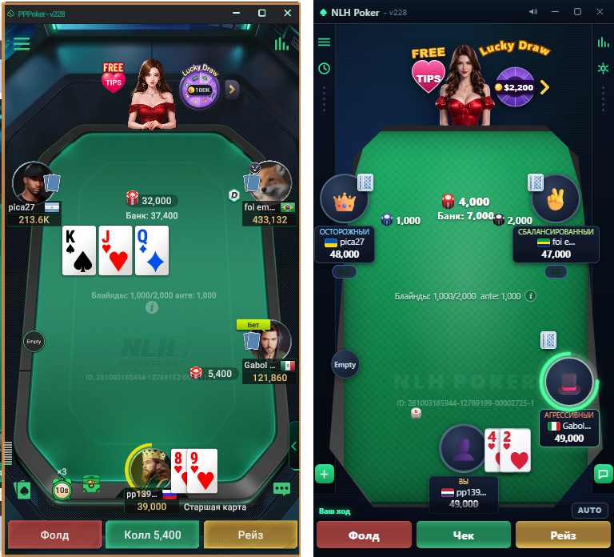
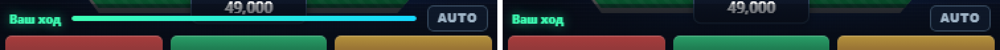
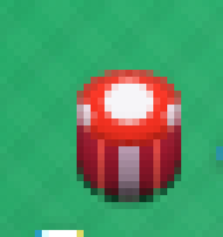

# NLH Poker v1.0

Клон покерного клиента (No-Limit Hold'em) с оригинальным оформлением: octagonal
зелёный сукно, дилер, бейджи FREE TIPS и Lucky Draw, места вокруг стола,
панель действий со слайдером рейза. Отсчёт времени хода показывает только
круговое кольцо вокруг аватара; горизонтальной полосы-дублёра в панели нет.

Слева — референс, справа — клон. Оба снимка сделаны в одном и том же размере
окна 376 × 696 px, поэтому кадры совпадают пиксель в пиксель и любые отличия —
это отличия самой вёрстки, а не масштаба:



Осознанные отличия от референса: у эталона по периметру идёт оливково-золотая
рамка окна Android-эмулятора (она занимает ~6 px по краям) — это часть хоста,
а не игры, поэтому в клоне она не воспроизводится; брендинг «PPРoker» заменён
на «NLH Poker - v228»; стеки сокращаются (`213.6K`, `433,132` → `48,000`).

Отсчёт времени хода героя — **только** круговое кольцо вокруг аватара (5 с дуга,
затем 5 с пульс). Горизонтальная полоса-дублёр в шапке панели действий убрана:
она повторяла то же время второй раз, а у эталона такой полосы нет вовсе.
Слева — как было, справа — как стало (кроп 3×, шапка панели действий):



Проверено на живом ходу героя: `#turnSec` тикает (`10 → 9`), кольцо анимируется
(`stroke-dashoffset -3.33px → -33.67px` за 1.5 с), полосы в DOM нет.

Сравнение собрано воспроизводимой командой (карты, стеки и банк в кадре
детерминированы зёрном, поэтому снимок повторяется почти байт в байт — от
прогона к прогону «плавает» только живая фаза анимации кольца хода):

```powershell
node tools\viz.mjs capture --url http://127.0.0.1:8770/ --w 376 --h 696 --seed 42 --wait 1500 `
  --eval "document.getElementById('actionbar').hidden=false;" --out clone.png
node tools\viz.mjs side --a screenshots\ref2.png --b clone.png --out screenshots/ref2-vs-clone.png
```

## Посадка мест и карты соперников

Пять видимых мест (`0` — герой внизу, `1` — пустое слева, `2` — верх-слева,
`3` — верх-справа, `4` — низ-справа, пятое место скрыто). Карты соперников
пересняты с эталона по пикселям, а не на глаз:

- Рубашка соперника — мини-карта **15 × 22 px**, вторая накрывает первую так,
  что видно ровно **5 px** кромки. Замер `ref2.png` по строке `y=224`: белые
  канты пары стоят на `x=55`, `60`, `74`, то есть пара `20 × 22` на `x 55..74`,
  а `x=75` — уже зелёное сукно. В `.cards` зазор `2 px`, поэтому
  `margin-left = offset - gap - w = 5 - 2 - 15 = -12 px`.
- Левое место: аватар `x 8..70`, значит пара лежит на нём верх-в-верх, уходит
  на 15 px внутрь и торчит на 4 px правее кромки аватара. Правое верхнее место —
  зеркало (пара `268..287`); нижнее правое — над аватаром: правый край пары на
  15 px правее левой кромки аватара, низ — на 10 px выше его верха.
- `z-index: 5` у карт против `3` у `.ring`: кольцо хода проходит **под** картами,
  как у героя. Карты героя — `39 × 55 px` с перекрытием ~19–20 px, борд — `44 × 62`.

## Запуск

Вариант 1 — двойной клик по `start.ps1` (PowerShell 5.1+):

```powershell
powershell -NoProfile -ExecutionPolicy Bypass -File start.ps1
```

Сервер поднимется на `http://127.0.0.1:8770/` и откроется в браузере.

Вариант 2 — любой статический сервер из папки проекта:

```powershell
python -m http.server 8770   # или
npx serve .
```

Вариант 3 — просто открыть `index.html` двойным кликом: сайт статический,
ES-модули не используются, всё работает и с `file://`.

## Правила и механика

- No-Limit Texas Hold'em, 6-макс, блайнды 1,000/2,000, анте 1,000 (мёртвые деньги).
- Все садятся с одинаковым банкроллом — 50,000 у каждого; докупка при стеке < 4 BB.
- Дилер ходит по кругу: кнопка переезжает к следующему живому игроку каждую раздачу
  (блайнды и первый ход в префлоп считаются от кнопки).
- Два места из шести пустые («Empty») — их можно занять кликом.
- Полный движок: блайнды, анте, олл-ины, сайд-поты, возврат незакрытой ставки,
  сплит-поты, лимит рейза (мин. рейз = размер предыдущего).
- Оценка рук 7 карт (стрит-флеш, каре, фулл-хаус ... колесо A-2-3-4-5).
- Боты трёх характеров — агрессивный, сбалансированный и осторожный (см. раздел
  «Типы ботов»); учитывают силу руки, дро (флеш/стрит-дро, гатшоты), позицию и
  пот-оддсы; думают как человек: 0,75–2 с в префлопе и 1,2–2,8 с на флопе/терне/ривере
  (решение об алл-ине — быстрее), плюс пауза 0,3–0,7 с после хода.
- Индикатор хода: на ход (и игроку, и боту) даётся 10 секунд. В начале хода вокруг
  аватара появляется сплошной зелёный круг, который первые 5 секунд равномерно
  «протирается» **по часовой стрелке**: пробел открывается ровно от 12 часов и
  расширяется вправо, а остаток дуги всегда примыкает к 12 часам слева и по мере
  укорачивания перетекает зелёный → жёлтый → красный. На 5-й секунде дуга исчезает,
  и дальше красный круг пульсирует **раз в секунду** до конца хода.

## Типы ботов

За столом три характера. Тип закреплён за местом (поле `styleIdx`) и виден прямо
в табличке игрока — цветной подписью над ником: у героя вместо типа стоит «Вы».

| Тип | Подпись | Как играет |
|---|---|---|
| Агрессивный | оранжевая | широко входит в банк (VPIP ≈ 32%), на префлопе открывает рейзом, а не лимпом; часто рейзит вместо колла, блефует, ставит крупно |
| Сбалансированный | зелёная | тайтово-агрессивно (VPIP ≈ 24%): ставки по силе руки и позиции, умеренные блефы |
| Осторожный | голубая | только сильные руки (VPIP ≈ 12%), почти не блефует, отвечает мелко, но доживает до вскрытия с лучшей рукой |

Характер задаётся не набором костылей «если рука X — делай Y», а шестью числами
в `PERSONALITIES` (`js/ai.js`), которые подставляются в одну и ту же модель
решения:

| Параметр | Смысл | Агрессивный | Сбалансированный | Осторожный |
|---|---|---|---|---|
| `openTh` | порог оценки для входа в игру на префлопе | 34 | 44 | 52 |
| `aggro` | склонность рейзить вместо колла и пушить | 0.88 | 0.55 | 0.22 |
| `bluff` | частота блеф-рейзов со слабой рукой | 0.30 | 0.12 | 0.03 |
| `valueTh` | с какой оценки рука считается «монстром» | 74 | 80 | 86 |
| `chase` | множитель ценности дро (догонять ли флеш/стрит) | 1.25 | 1.00 | 0.72 |
| `size` | множитель размера ставки | 1.20 | 1.00 | 0.82 |

Порог `openTh` откалиброван по фактическому распределению оценок всех 1326
стартовых рук (`node tools\calib-preflop.js`): 34 → 42% лучших рук, 44 → 23%,
52 → 14%. Дополнительно у каждого характера свой разброс случайности (`noise`),
поэтому два бота одного типа не играют одинаково.

Проверяется это измеримо, а не на глаз — `node tools\test-bots.js 4000` сажает
за стол по два бота каждого типа, отключает анимации и считает VPIP, PFR, долю
агрессивных действий, олл-инов и побед на вскрытии. Эталонный прогон:

```
тип                 рук    VPIP%   PFR%   агр%   колл%  чек%   фолд%  олл-ин  вскрыт.  побед на вскрытии
агрессивный         8000   31.9    17.1   20.7   12.8   23.4   43.1   106     884      41.1%
осторожный          8000   12.4    1.5    1.8    10.0   24.4   63.8   16      762      49.2%
сбалансированный    8000   23.8    5.5    7.1    15.7   27.6   49.6   39      1009     44.3%
```

Тест падает, если порядок нарушен: VPIP и агрессия обязаны возрастать от
осторожного к агрессивному. Доля побед на вскрытии при этом у агрессивного должна
быть ниже, чем у обоих тайтовых типов — он доходит до вскрытия с более слабыми
руками. Строгий порядок между сбалансированным и осторожным намеренно не
проверяется: на 700–1000 вскрытий разница в 1–2 пункта лежит внутри стандартной
ошибки доли, и такая проверка была бы флаки.

## Фишки

Фишки — не кружки, а объёмные цилиндры в изометрии: сверху эллипс верхней
грани, снизу — торец с рёбрами. Всё собрано на CSS, без картинок.



Ключевые решения (все подобраны замерами эталонного скриншота, а не на глаз):

- **Силуэт — капсула, а не эллипс.** `border-radius: 50% / calc(var(--d) * var(--sq) / 2)`
  даёт горизонтальный радиус `d/2` и вертикальный `d·sq/2`, поэтому между дугами
  остаётся ровный вертикальный участок высотой ровно `--t`. Обычный `50%` сужает
  бока в ноль, и на 15 px фишка читается сплюснутым яйцом.
- **Геометрия живёт только на `.pile`.** Переменные `--d/--t/--sq/--step` объявлены
  на контейнере `.pile`, а на `.ichip` — только цвета. Если объявить их и на
  `.ichip`, внутренний элемент перекроет унаследованные значения, и размеры
  `.pile--sm/--md/--lg` и кнопки дилера до фишки не дойдут.
- **Торец — крупная схема, а не гребёнка.** Замер эталона (ряд `y=249`):
  `#93172b → #d1433f → #971026 → вкладыш #ad91a5 (3 px) → …`. Поэтому торец —
  тёмно-багровые полосы, **узкая** алая вспышка и широкий сиреневый вкладыш по
  центру. Частая мелкая гребёнка на 15 px распадается в бахрому.
- **Грань — ровный алый с компактным холодным пятном.** Эталон даёт `#f73628`
  по всей грани, а вкладыш — 3–4 px из 15 в цвете `#f5f7f8`. Широкое пятно или
  мягкий ореол читаются бликом, и фишка расплывается.
- **Вспышка торца — своя у каждого номинала** (`--ca` в `CHIP_COLORS`), иначе
  зелёная фишка получает красные зубцы от красной.

Стопка растёт от суммы: ставка — `1 + floor(bet / 7000)` фишек (до 3), банк —
`2 + floor(shown / 9000)` (до 5). Палитра номиналов поворачивается по номеру
места, так что соседние ставки не сливаются в одно пятно.

## Управление

| Действие | Как |
|---|---|
| Fold | `F` или кнопка FOLD |
| Check / Call | `C` или кнопка CALL n / CHECK |
| Raise (открыть) | `R` |
| Подтвердить рейз | `Enter` |
| Сумма рейза | слайдер, стрелки `←`/`→`, пресеты ½ / ¾ / Pot / Max |
| Авто-чек/колл | чекбокс AUTO (сработает через 1.2 с) |
| Занять пустое место | клик по метке «Empty» |

На ход даётся 10 секунд, потом автоматически чек или колл.

## Структура

```
index.html          разметка окна приложения
css/styles.css      все стили (тёмная тема, неон, сукно)
js/evaluator.js     оценка 7 карт и сравнение рук
js/deck.js          колода и рендер карт (HTML/CSS): индекс в углу + крупная масть
js/ai.js            боты: три характера (агрессивный/сбалансированный/осторожный)
js/engine.js        движок стола: раздачи, круги ставок, банки, шоудаун
js/ui.js            привязка движка к DOM, панель действий, звук
assets/dealer.png   картинка дилера с прозрачным фоном (рисуется позади стола)
tools/analyze.ps1   ASCII-анализ скриншота (вспомогательный)
tools/viz.mjs       захват/замер/дифф скриншотов без зависимостей (Node 20+)
tools/ring-lab.html изолированный стенд кольца хода (однотонный фон, без сукна)
tools/measure.mjs   замер геометрии фишки по строкам PNG (без зависимостей)
tools/col.mjs       смена цветов по строке/столбцу PNG (без зависимостей)
tools/test-engine.js headless-тесты движка и стресс-прогон
tools/test-bots.js  замер характеров ботов (VPIP/PFR/агрессия) + проверки порядка
tools/calib-preflop.js распределение префлоп-оценки по всем 1326 рукам
```

## Инструмент `tools/viz.mjs`

Тот же пайплайн, которым верстался этот клон, собранный в один файл без
зависимостей — только Node 20+ (использует встроенные `fetch` и `WebSocket`).
Ни npm-пакетов, ни ImageMagick, ни Python не требуется.

Четыре задачи, которые обычно требуют четырёх разных инструментов:

| Команда | Зачем |
|---|---|
| `capture` | скриншот ровно в заданном размере вьюпорта |
| `probe`   | измерение геометрии по цветовым классификаторам |
| `diff`    | сравнение с эталоном и локализация отличий |
| `crop` / `side` | увеличенный фрагмент и склейка «до/после» |

Главная тонкость — `capture`. Headless Chrome молча игнорирует `--window-size`
меньше реального минимума окна ОС (на Windows это ≈500×605), и вместо кадра
376×696 отдаёт обрезанный по левому краю. `viz.mjs` ставит размер через
`Emulation.setDeviceMetricsOverride`, поэтому получает ровно 376×696 независимо
от размера настоящего окна — раньше для этого приходилось рендерить страницу
в `<iframe>` точного размера и обрезать пиксели вручную.

```powershell
# захват + геометрия нужных элементов
node tools\viz.mjs capture --url http://127.0.0.1:8770/ --w 376 --h 696 --out shot.png `
  --select ".felt,.table,.act-row"

# воспроизводимый кадр: одинаковое зерно -> одинаковая раздача
node tools\viz.mjs capture --url http://127.0.0.1:8770/ --w 376 --h 696 --seed 42 `
  --eval "document.getElementById('actionbar').hidden=false;" --out shot.png

# полоса кнопок действий (ищем непрерывную полосу красного)
node tools\viz.mjs probe --file shot.png --y0 640 --y1 695 --mode band --class red --min-count 100

# горизонтальные границы кнопок в строке
node tools\viz.mjs probe --file shot.png --rows 668 --mode runs --class red,green,gold --min-run 4
```

Флаг `--seed` подменяет `Math.random()` **до** загрузки скриптов страницы, поэтому
детерминированы и раздача, и задержки ботов. Два захвата с одним зерном дают
`mean |Δ| = 0.000`; без него дифф тонет в отличиях случайной раздачи (77 % пикселей).
Это то, что позволяет сравнивать кадры с эталоном по существу, а не по совпадению.

Классификаторы (`node tools\viz.mjs classes`) — калиброванные пороги вроде
`felt` (`g > r+16 && g > b+8 && g > 55`) и `grey` для кожи рейла. Пороги подобраны
эмпирически по реальным скриншотам; `red` намеренно отсекает `g-b >= 35`, иначе
оливково-золотая рамка эмулятора (`191,133,71`) проходит как «красная».

Любая команда принимает `--json` для машинного вывода, `--help` печатает справку.

### Замер анимаций

Анимацию почти невозможно поймать скриншотом: к моменту съёмки она уже уехала
вперёд. Поэтому `--eval` умеет **замораживать** CSS-анимацию на точном
миллисекунде через Web Animations API:

```powershell
# кадр, в котором кольцо хода заморожено ровно на 2.5 с
$js = "document.querySelectorAll('.seat.is-turn .bar, .seat.is-turn .pul').forEach(function(el){el.getAnimations().forEach(function(a){a.pause();a.currentTime=2500;});});"
node tools\viz.mjs capture --url http://127.0.0.1:8770/ --w 376 --h 696 --seed 42 `
  --wait-for ".seat.is-turn .bar" --eval-wait 500 --eval $js --out shot.png

# из какого сектора кольца ушла дуга (0° = 12 часов, градусы растут по часовой)
node tools\viz.mjs probe --file shot.png --mode arc --cx 320 --cy 477 --r 32 --r2 38 `
  --class green,gold,red,grey --step 1
```

Режим `probe --mode arc` обходит кольцо по градусам, берёт самый насыщенный
пиксель в радиальном коридоре `--r..--r2` и печатает, какими классами и с какого
по какой угол покрыта каждая часть окружности. На живой странице у верхних ~44°
в коридор попадает зелёное сукно, поэтому направление удобнее мерить на
изолированном стенде `tools/ring-lab.html` (то же кольцо, однотонный фон):

```powershell
node tools\viz.mjs capture --url http://127.0.0.1:8770/tools/ring-lab.html --w 620 --h 300 `
  --out lab.png --wait 600 --eval "document.title=window.measure(2500)" --eval-wait 60
node tools\viz.mjs probe --file lab.png --mode arc --cx 310 --cy 140 --r 92 --r2 102 `
  --class green,gold,red,grey,darkish --step 2
```

Замер на стенде: пробел начинается у 0° и его ведущая кромка за секунды
1/2/3/4/5 доходит до 68° → 140° → 208° → 278° → 360° (линейно, ±несколько
градусов — сглаживание кромки), то есть дуга идёт строго по часовой стрелке от
12 часов и за 5 секунд укорачивается от полного круга до нуля: на t = 4,8 с
остаётся ~14° красной дуги, на t = 5 с её уже нет. Остаток дуги совпадает с
CSS-таймлайном: t = 3 c → ~40/100 дуги, t = 4 c → ~20/100 (72°). Пульс
начинается только **после** дуги (задержка 5 с) и даёт ровно пять ударов, по
одному в секунду: `stroke-opacity` круга `.pul` равен единице на
5,1 / 6,1 / 7,1 / 8,1 / 9,1 с и нулю между ними; на всём протяжении дуги
(0–5 с) пульс неактивен.

## Тесты движка

```powershell
node tools\test-engine.js 1000
```

Проверяются: консервация фишек (сумма стеков + банка неизменна), неотрицательные
стеки, ≤2 карты у игрока, ≤5 карт на борде, корректное число участников раздачи.
Эталонный прогон: 1000 раздач (445 шоудаунов, 555 фолд-ов), 0 нарушений.
Дополнительно: 100 раздач с пустым 6-м местом — пустое место не получает карт,
не ставит фишки и не участвует в раздаче.

## Тесты ботов

```powershell
node tools\test-bots.js 4000
```

Шесть мест, по два бота каждого характера, анимации отключены, стеки докупаются
перед раздачей (иначе за тысячи рук все разорятся и статистика опустеет). Считаются
VPIP, PFR, доли агрессивных действий / коллов / чеков / фолдов, олл-ины, вскрытия
и доля побед на них; внутри каждой раздачи проверяется консервация фишек.
Тест падает, если порядок нарушен — например, если осторожный вдруг начнёт входить
в банк чаще агрессивного или выигрывать на вскрытии реже него.

Распределение префлоп-оценки, по которому выставлены пороги, показывает
`node tools\calib-preflop.js`.
